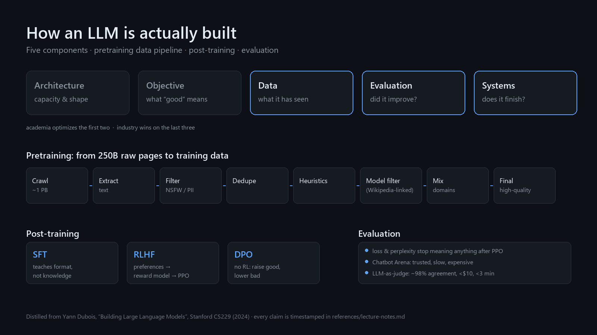

# llm-building-map

**A skill file that tells an agent how an LLM is actually built — and gives you three questions that deflate most benchmark claims.**

[](LICENSE) [](SKILL.md) [](references/lecture-notes.md)



```bash
git clone https://github.com/lizhao888/llm-building-map.git
cp -r llm-building-map ~/.claude/skills/      # Claude Code
cp -r llm-building-map ~/.hermes/skills/research/   # Hermes Agent
```

Distilled from Yann Dubois' Stanford CS229 guest lecture *Building Large Language Models* (Summer 2024). Every claim in the skill is mapped to a timestamp in `references/lecture-notes.md`, so you can check it rather than trust it.

📖 Prefer to read it as an article? [How LLMs are actually built — on dev.to](https://dev.to/lizhao888/how-llms-are-actually-built-and-why-most-how-it-works-threads-stop-too-early-pm) · [中文版（掘金）](https://juejin.cn/post/7697159608205885450)

## Why this exists

Most "how LLMs work" explainers stop at "transformers + attention". The parts that decide whether a model is good — the data pipeline, the post-training recipe, the evaluation setup, the systems work — are usually glossed over.

This skill covers those parts, in the form an agent can actually use:

- **Explain**: a structure for AI explainer content that isn't hand-waving.
- **Audit**: three questions that deflate most benchmark claims (which benchmark, against whom, judged by what).
- **Scope**: why "let's fine-tune it on our docs" rarely does what people expect.

## What's inside

```
SKILL.md                          # the skill itself (five components, pipeline, post-training, eval)
references/lecture-notes.md       # evidence map: claim → timestamp in the source lecture (English)
references/lecture-notes.zh-CN.md # same content, in Chinese
```

## Install

**Claude Code / Claude Skills**

```bash
git clone https://github.com/lizhao888/llm-building-map.git
mkdir -p ~/.claude/skills
cp -r llm-building-map ~/.claude/skills/llm-building-map
```

**Hermes Agent**

```bash
cp -r llm-building-map ~/.hermes/skills/research/llm-building-map
# Windows: %LOCALAPPDATA%\hermes\skills\research\llm-building-map
```

**Any other agent that reads `SKILL.md`**: drop the directory wherever that agent looks for skills. The frontmatter follows the common `name` + `description` convention.

## The 60-second version

| Component | What it decides | Who optimizes it |
|-----------|-----------------|------------------|
| Architecture | capacity and shape | academia |
| Objective | what "good" means during training | academia |
| **Data** | what the model has seen | industry |
| **Evaluation** | whether you can tell it improved | industry |
| **Systems** | whether training finishes at all | industry |

Pretraining compresses the internet into a next-token model. Post-training turns that model into an assistant: SFT teaches format and persona (not knowledge), RLHF/DPO align it to preferences. Evaluation is where most claims quietly break.

## Scope and honesty

- Unofficial study notes. Not affiliated with Stanford, Anthropic, or the speaker.
- The lecture is from 2024; newer methods (long context, reasoning models, synthetic data pipelines) are out of scope and flagged as such.
- Where the speaker hedges ("I think", "I'm not sure"), the notes keep the hedge instead of upgrading it to fact.

## License

MIT — see [LICENSE](LICENSE).
